# BREE WISTERIA LANE: The Garden Supper — Housewife Life Simulation & Strategy Game

> **BREE** is an ambitious browser-game project combining tactical action, culinary time management, character-driven role-playing, estate management, and suburban social strategy.
>
> **BREE** stands for:
>
> - **Bullets, Rebels, Elegance, Excellence** — action and tactical gameplay.
> - **Baking, Recipes, Efficiency, Etiquette** — culinary and hospitality gameplay.
> - **Butler, Ruler, Estate, Empire** — management, strategy, and progression.

<p align="center">
  <strong>A world of impeccable manners, complicated relationships, ambitious plans, and unexpected consequences.</strong>
</p>

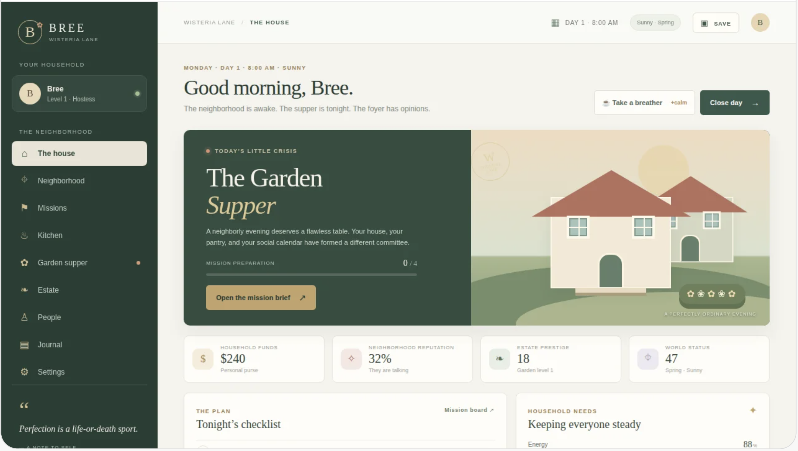
---

# Table of Contents

1. [Project Overview](#1-project-overview)
2. [Game Vision and Design Philosophy](#2-game-vision-and-design-philosophy)
3. [Core Gameplay Pillars](#3-core-gameplay-pillars)
4. [Technology Stack](#4-technology-stack)
5. [System Architecture](#5-system-architecture)
6. [Application Structure](#6-application-structure)
7. [Game State and Data Architecture](#7-game-state-and-data-architecture)
8. [Gameplay Loop](#8-gameplay-loop)
9. [Character and Relationship System](#9-character-and-relationship-system)
10. [Story, Dialogue, and Quest System](#10-story-dialogue-and-quest-system)
11. [Action and Tactical Gameplay](#11-action-and-tactical-gameplay)
12. [Cooking, Baking, and Catering](#12-cooking-baking-and-catering)
13. [Estate and Household Management](#13-estate-and-household-management)
14. [Neighborhood Simulation](#14-neighborhood-simulation)
15. [Economy and Progression](#15-economy-and-progression)
16. [Saving, Loading, and Persistence](#16-saving-loading-and-persistence)
17. [User Interface and Accessibility](#17-user-interface-and-accessibility)
18. [Testing, Quality, and Security](#18-testing-quality-and-security)
19. [Development, Build, and Deployment](#19-development-build-and-deployment)
20. [Roadmap, Contribution, and Project Standards](#20-roadmap-contribution-and-project-standards)

---

# 1. Project Overview

## 1.1 What is BREE?

BREE is a browser-first game concept built around a fictional suburban community where appearances matter, relationships are complicated, and everyday activities can have surprisingly large consequences.

Players take part in a connected world featuring:

- Character relationships and personal histories.
- Household and estate management.
- Cooking, baking, recipes, and catering.
- Tactical missions and investigative activities.
- Neighborhood politics and community diplomacy.
- Secrets, gossip, mysteries, and branching storylines.
- Resource management and economic progression.
- Events, competitions, and social gatherings.
- Persistent consequences influenced by player decisions.

The goal is to create a cohesive game rather than a collection of unrelated minigames.

A player's success in one gameplay area should influence the others.

For example:

- A successful catering event can improve social reputation.
- Improved reputation can unlock invitations and new quests.
- A new relationship can reveal information about a neighborhood mystery.
- Completing an investigation can unlock a new estate project.
- An estate upgrade can improve cooking efficiency or staff performance.

## 1.2 Project objectives

The project aims to deliver:

1. A playable browser-based experience.
2. A responsive interface suitable for desktop and mobile browsers.
3. A modular codebase that supports future expansion.
4. A data-driven content system.
5. Persistent game progression.
6. Interconnected gameplay systems.
7. Original characters, locations, dialogue, and storylines.
8. Testable and maintainable software.
9. A foundation for additional chapters and content updates.

## 1.3 Project status

This README describes the intended architecture and development direction. It does not certify that every described system is already implemented.

Use the following status labels when updating the project:

| Status | Meaning |
|---|---|
| Planned | Designed but not implemented |
| In progress | Currently being developed |
| Implemented | Present in the codebase |
| Tested | Verified through documented tests |
| Released | Available in a published build |

## 1.4 Repository

**GitHub:** https://github.com/lucylow/bree-web-game

The repository is the central location for source code, documentation, issue tracking, and future releases.

---

# 2. Game Vision and Design Philosophy

## 2.1 The central experience

BREE should feel like an interactive suburban drama in which the player has meaningful control over everyday life.

The experience should balance:

- Humor and tension.
- Elegance and chaos.
- Strategy and improvisation.
- Cooperation and competition.
- Personal relationships and community responsibilities.
- Short activities and long-term objectives.

The world should react to the player's choices.

A decision should not feel meaningless simply because it happens during an ordinary activity.

## 2.2 Core design principles

### Principle 1: Connected gameplay

Every major gameplay pillar should interact with at least one other pillar.

### Principle 2: Meaningful decisions

Choices should have understandable consequences. Some consequences can be immediate, while others may appear later.

### Principle 3: Persistent progression

The player should be able to leave the game and return without losing important progress.

### Principle 4: Original storytelling

All characters, settings, dialogue, artwork, and storylines should be original or properly licensed.

### Principle 5: Expandable architecture

New recipes, characters, missions, buildings, quests, and events should be addable without rewriting unrelated systems.

### Principle 6: Player accessibility

The game should be understandable, navigable, and playable across supported devices and input methods.

## 2.3 The experience cycle

The overall experience can be summarized as:

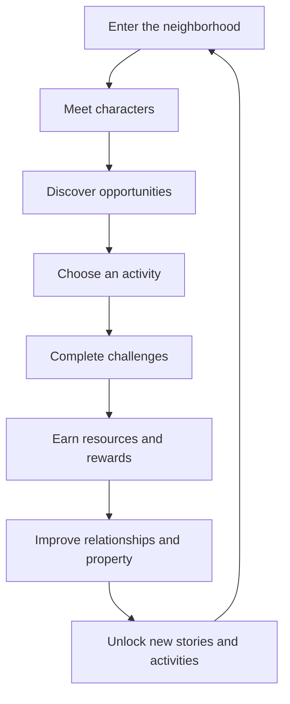

## 2.4 Design priorities

Recommended development priorities:

1. Make the game launch reliably.
2. Make its central gameplay loop enjoyable.
3. Make player actions produce visible results.
4. Save and restore progression correctly.
5. Connect gameplay systems.
6. Expand content.
7. Improve presentation, performance, and accessibility.

A smaller, fully working experience is preferable to a large interface full of nonfunctional buttons.

---

# 3. Core Gameplay Pillars

BREE has three primary gameplay pillars.

## 3.1 Action: Bullets, Rebels, Elegance, Excellence

The action pillar provides tactical challenges and investigative gameplay.

Potential activities include:

- Exploring mission environments.
- Avoiding detection.
- Investigating suspicious activity.
- Protecting important characters.
- Solving environmental puzzles.
- Using non-lethal tools.
- Completing objectives under time constraints.
- Managing mission resources.

The emphasis should be on thoughtful, stylish gameplay rather than graphic violence.

## 3.2 Culinary management: Baking, Recipes, Efficiency, Etiquette

The culinary pillar focuses on preparing food, managing time, and satisfying guests.

Potential activities include:

- Gathering ingredients.
- Discovering recipes.
- Preparing meals.
- Baking desserts.
- Managing kitchen equipment.
- Completing timed cooking tasks.
- Organizing catering events.
- Responding to guest requests.
- Managing food quality and freshness.

## 3.3 Strategy: Butler, Ruler, Estate, Empire

The strategy pillar allows players to improve their property and influence their community.

Potential activities include:

- Expanding the estate.
- Hiring and training staff.
- Managing household schedules.
- Building facilities.
- Controlling expenses.
- Organizing community projects.
- Negotiating neighborhood rules.
- Improving property prestige.
- Managing relationships between residents.

## 3.4 Pillar interaction matrix

| System | Action | Culinary | Estate |
|---|---|---|---|
| Reputation | Mission results | Guest reviews | Community standing |
| Resources | Equipment rewards | Ingredient costs | Construction budgets |
| Characters | Mission contacts | Guests and chefs | Staff and residents |
| Quests | Investigations | Competitions | Development projects |
| Progression | Tactical skills | Culinary skills | Management skills |

## 3.5 Shared world rule

All three pillars should use common systems for:

- Time.
- Player progression.
- Character relationships.
- Reputation.
- Inventory.
- Currency.
- Quest completion.
- World events.
- Notifications.
- Save data.

This prevents each gameplay mode from becoming a separate application.

---

# 4. Technology Stack

## 4.1 Recommended technology

The project direction uses a modern browser-development stack.

| Technology | Purpose |
|---|---|
| React | Component-based user interface |
| TypeScript | Static typing and safer development |
| Vite | Development server and production bundling |
| HTML | Application structure |
| CSS | Styling and responsive layouts |
| JavaScript | Runtime application logic |
| LocalStorage or IndexedDB | Browser-side persistence |
| Git | Version control |
| GitHub | Repository hosting and collaboration |

The actual installed package versions and scripts should be verified against `package.json` and the lockfile.

## 4.2 Frontend architecture

React should manage the interface and component lifecycle.

TypeScript should define the structure of game data, gameplay actions, and system boundaries.

Vite should provide fast development builds and production output.

## 4.3 Suggested dependencies

Add dependencies only when they solve a real project requirement.

Potential categories include:

- Routing.
- State management.
- Form validation.
- Animation.
- Icon libraries.
- Testing.
- Browser storage.
- Data validation.

Do not add large libraries simply because they are popular.

## 4.4 Development requirements

Recommended development environment:

- Node.js with an actively supported LTS release.
- npm or another consistently selected package manager.
- Git.
- A modern browser.
- A code editor with TypeScript support.

## 4.5 Architecture rule

The UI should not contain all gameplay logic.

For example, calculating a recipe's quality should belong to a gameplay service or domain function, not be duplicated inside multiple React components.

---

# 5. System Architecture

## 5.1 High-level architecture

The application should be organized into presentation, application logic, domain systems, and persistence.

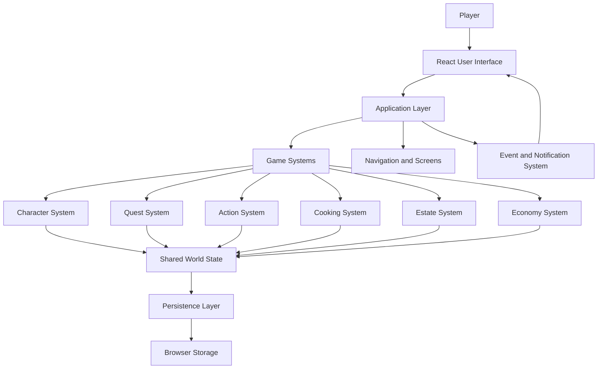

## 5.2 Presentation layer

Responsibilities:

- Render screens.
- Display character information.
- Show inventory and resources.
- Display objectives and quests.
- Collect player input.
- Present notifications.
- Provide accessible navigation.

The presentation layer should not independently modify saved data.

## 5.3 Application layer

Responsibilities:

- Coordinate player actions.
- Route commands to game systems.
- Handle screen transitions.
- Manage user-facing errors.
- Coordinate save operations.
- Connect gameplay events to notifications.

## 5.4 Domain layer

The domain layer contains the rules of the game.

Examples:

- Can the player complete this quest?
- Does the player have enough ingredients?
- Can the estate afford a building?
- How does this decision affect a relationship?
- What rewards should a mission provide?

Domain logic should be testable without rendering the UI.

## 5.5 Persistence layer

Responsibilities:

- Save player progress.
- Load existing saves.
- Validate stored data.
- Migrate old save versions.
- Recover from corrupted or invalid data where possible.

## 5.6 Dependency direction

Prefer this direction:

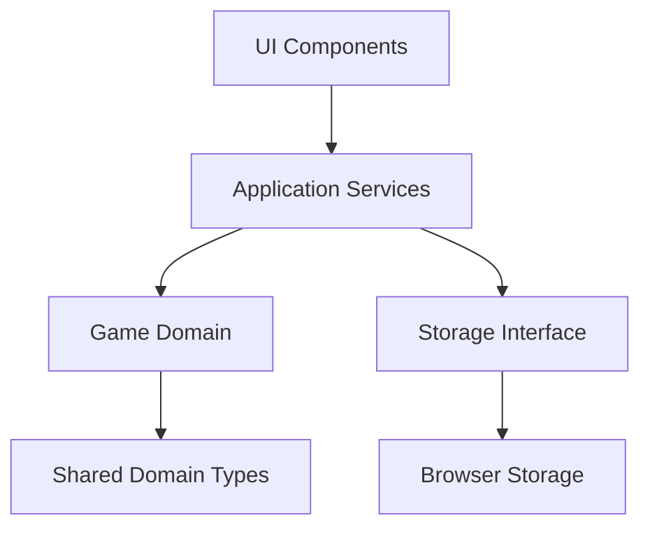

Domain rules should not depend on React components.

---

# 6. Application Structure

## 6.1 Suggested directory structure

The following is a recommended organization. Adapt it to the repository's actual structure rather than creating duplicate folders.

```text
bree-web-game/
│
├── public/
│   ├── images/
│   ├── icons/
│   ├── audio/
│   └── fonts/
│
├── src/
│   ├── app/
│   │   ├── App.tsx
│   │   ├── routes.ts
│   │   └── providers/
│   │
│   ├── components/
│   │   ├── common/
│   │   ├── navigation/
│   │   ├── characters/
│   │   ├── inventory/
│   │   ├── dialogue/
│   │   └── notifications/
│   │
│   ├── features/
│   │   ├── action/
│   │   ├── cooking/
│   │   ├── estate/
│   │   ├── neighborhood/
│   │   ├── quests/
│   │   └── relationships/
│   │
│   ├── systems/
│   │   ├── economy/
│   │   ├── progression/
│   │   ├── reputation/
│   │   ├── world/
│   │   └── time/
│   │
│   ├── data/
│   │   ├── characters/
│   │   ├── dialogue/
│   │   ├── missions/
│   │   ├── recipes/
│   │   ├── buildings/
│   │   └── quests/
│   │
│   ├── services/
│   │   ├── saveService.ts
│   │   ├── loadService.ts
│   │   └── validationService.ts
│   │
│   ├── hooks/
│   ├── types/
│   ├── utils/
│   ├── styles/
│   └── main.tsx
│
├── tests/
│   ├── unit/
│   ├── integration/
│   └── e2e/
│
├── docs/
│   ├── architecture.md
│   ├── game-design.md
│   └── data-model.md
│
├── package.json
├── package-lock.json
├── tsconfig.json
├── vite.config.ts
└── README.md
```

## 6.2 Feature organization

Each major feature should contain the files needed to implement that feature.

For example:

```text
features/cooking/
├── components/
│   ├── KitchenScreen.tsx
│   ├── RecipeCard.tsx
│   └── CookingTimer.tsx
├── services/
│   ├── cookingService.ts
│   └── recipeService.ts
├── types.ts
└── index.ts
```

This makes features easier to test and maintain.

## 6.3 Naming conventions

Recommended conventions:

- React components: `PascalCase`.
- Functions: `camelCase`.
- Types and interfaces: `PascalCase`.
- Constants: `UPPER_SNAKE_CASE` when appropriate.
- Data identifiers: stable strings such as `CHAR_001`.
- CSS classes: consistent descriptive names.

## 6.4 File responsibilities

Every file should have a clear responsibility.

Avoid:

- One enormous application component.
- Duplicated game rules.
- Multiple competing save systems.
- Unexplained global variables.
- Hardcoded content scattered throughout UI components.

---

# 7. Game State and Data Architecture

## 7.1 Central game state

BREE requires a coherent representation of the player's world.

A conceptual game state might look like:

```ts
interface GameState {
  version: number;
  player: PlayerState;
  world: WorldState;
  characters: CharacterState[];
  relationships: RelationshipState[];
  inventory: InventoryState;
  quests: QuestState[];
  estate: EstateState;
  economy: EconomyState;
  progression: ProgressionState;
  settings: GameSettings;
}
```

These are proposed interfaces, not confirmation that matching interfaces already exist in the repository.

## 7.2 Player state

```ts
interface PlayerState {
  id: string;
  displayName: string;
  level: number;
  experience: number;
  currentLocationId: string;
  currentHealth?: number;
  currentEnergy?: number;
}
```

Optional values should only be included if the relevant mechanic exists.

## 7.3 World state

```ts
interface WorldState {
  day: number;
  timeOfDay: string;
  weather: string;
  currentChapterId: string;
  completedEventIds: string[];
  unlockedLocationIds: string[];
}
```

## 7.4 Character state

```ts
interface CharacterState {
  id: string;
  name: string;
  personalityTags: string[];
  currentLocationId: string;
  scheduleId?: string;
  relationshipIds: string[];
  knownSecretIds: string[];
}
```

## 7.5 Data relationships

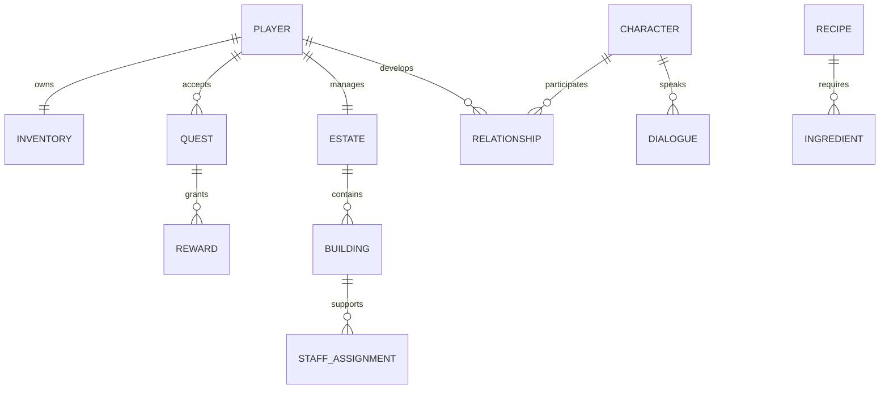

## 7.6 Stable identifiers

Every content record should have a stable identifier.

Examples:

```text
CHAR_001
QUEST_001
MISSION_001
RECIPE_001
INGREDIENT_001
BUILDING_001
LOCATION_001
EVENT_001
```

Do not use an array position as a permanent identifier.

Array positions can change when records are inserted, deleted, or reordered.

## 7.7 Data-driven content

Keep content separate from the UI.

For example:

```ts
interface Recipe {
  id: string;
  name: string;
  description: string;
  ingredientIds: string[];
  preparationTime: number;
  baseQuality: number;
  unlockLevel: number;
}
```

The UI should read recipe records and render them.

It should not require a custom component for every recipe.

---

# 8. Gameplay Loop

## 8.1 Daily gameplay cycle

The player should have a recognizable cycle of activities.

A typical in-game day might include:

1. Review household status.
2. Check the neighborhood.
3. Speak to characters.
4. Select activities.
5. Complete quests or missions.
6. Prepare meals or organize events.
7. Manage property and finances.
8. Review consequences.
9. Save progress.

## 8.2 Activity selection

Players should be able to choose how they spend their time.

Activities may include:

- Cooking.
- Shopping.
- Investigating.
- Socializing.
- Building.
- Training.
- Completing quests.
- Organizing events.
- Resting.

## 8.3 Activity flow

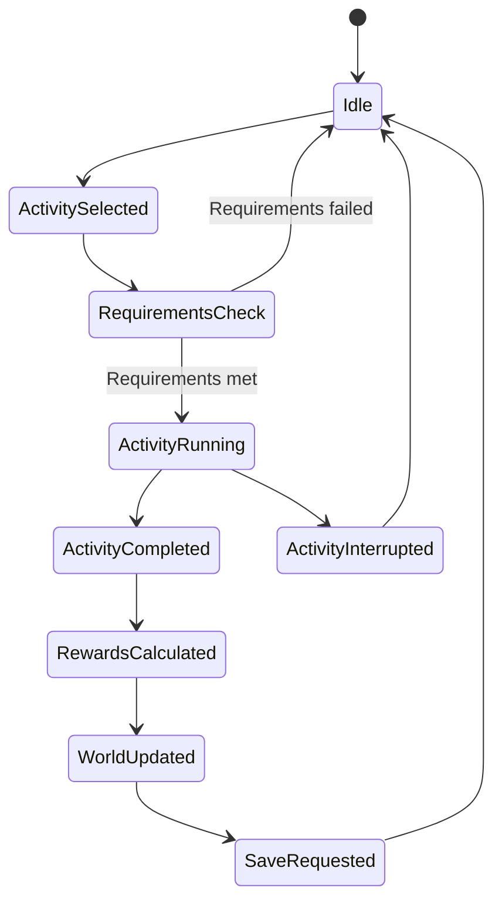

## 8.4 Time management

Time should be managed centrally.

Possible time units:

- Morning.
- Afternoon.
- Evening.
- Night.

More precise time tracking can be added later.

Activities should declare their time cost rather than independently changing the clock.

## 8.5 Consequence system

Consequences may affect:

- Relationships.
- Reputation.
- Available dialogue.
- Quest conditions.
- Guest satisfaction.
- Staff morale.
- Neighborhood opinion.
- Future story events.

A consequence should be applied through a controlled game-state update.

---

# 9. Character and Relationship System

## 9.1 Character design

Characters should have:

- Unique identifiers.
- Names.
- Personalities.
- Backgrounds.
- Goals.
- Motivations.
- Preferences.
- Relationships.
- Schedules.
- Dialogue.
- Story roles.

All characters and stories should be original or properly licensed.

## 9.2 Personality system

Personality tags can influence dialogue and reactions.

Example:

```ts
type PersonalityTag =
  | "ambitious"
  | "generous"
  | "competitive"
  | "reserved"
  | "dramatic"
  | "observant"
  | "loyal"
  | "suspicious";
```

A character can have multiple tags.

## 9.3 Relationship values

A relationship may track:

```ts
interface RelationshipState {
  characterAId: string;
  characterBId: string;
  friendship: number;
  trust: number;
  rivalry: number;
  respect: number;
  knownFacts: string[];
}
```

Keep values within documented limits.

For example, if a relationship uses a 0–100 scale, validate every update.

## 9.4 Relationship changes

Relationships can change when the player:

- Helps a character.
- Breaks a promise.
- Shares information.
- Keeps a secret.
- Wins a competition.
- Insults someone.
- Completes a shared project.
- Makes a public decision.

## 9.5 Character interaction diagram

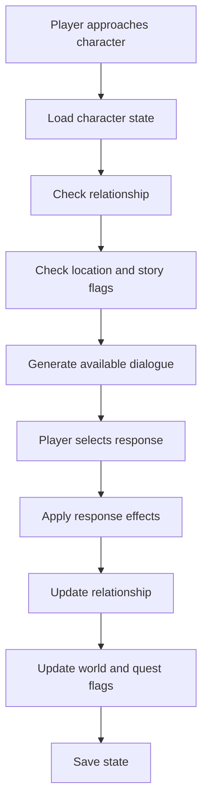

## 9.6 NPC behavior

A future character simulation may include:

- Daily schedules.
- Personal goals.
- Social preferences.
- Reactions to world events.
- Interactions with other characters.
- Memory of selected player decisions.

The system should be deterministic enough to test and debug.

---

# 10. Story, Dialogue, and Quest System

## 10.1 Story chapters

The narrative should be divided into chapters.

Each chapter can contain:

- Main quests.
- Side quests.
- Character introductions.
- Story events.
- Mystery clues.
- Choices.
- Rewards.
- Unlock conditions.

## 10.2 Dialogue structure

Dialogue should be represented as data.

Example:

```ts
interface DialogueChoice {
  id: string;
  text: string;
  nextNodeId?: string;
  requiredFlags?: string[];
  effects?: {
    friendship?: number;
    trust?: number;
    reputation?: number;
  };
}

interface DialogueNode {
  id: string;
  characterId: string;
  text: string;
  choices: DialogueChoice[];
}
```

## 10.3 Dialogue flow

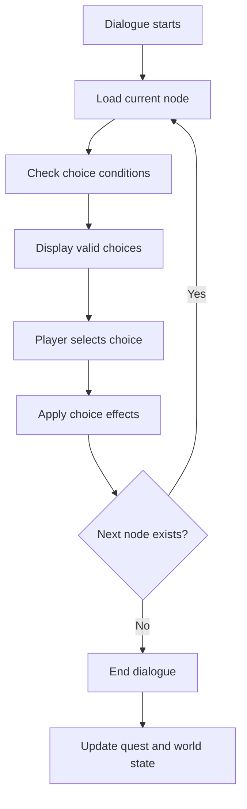

## 10.4 Quest architecture

A quest should define:

- ID.
- Title.
- Description.
- Starting conditions.
- Objectives.
- Completion conditions.
- Failure conditions, if applicable.
- Rewards.
- Follow-up quests.

Example:

```ts
interface Quest {
  id: string;
  title: string;
  description: string;
  objectiveIds: string[];
  prerequisiteQuestIds: string[];
  rewardIds: string[];
  repeatable: boolean;
}
```

## 10.5 Quest state

Possible states:

```ts
type QuestStatus =
  | "locked"
  | "available"
  | "active"
  | "completed"
  | "failed";
```

## 10.6 Mystery and clue progression

Mystery content can use a clue collection.

Players may:

- Discover evidence.
- Compare information.
- Question characters.
- Identify contradictions.
- Unlock new dialogue.
- Complete investigations.

Clues should be stored as structured data, not hidden in UI text.

---

# 11. Action and Tactical Gameplay

## 11.1 Action design

The action pillar should offer compact, replayable tactical experiences.

Potential mission objectives:

- Reach a destination.
- Protect a character.
- Locate an object.
- Investigate a scene.
- Avoid detection.
- Solve a puzzle.
- Complete a timed challenge.
- Escape safely.

## 11.2 Mission structure

```ts
interface Mission {
  id: string;
  title: string;
  description: string;
  locationId: string;
  objectiveIds: string[];
  rewardIds: string[];
  difficulty: number;
  timeLimitSeconds?: number;
}
```

## 11.3 Mission lifecycle

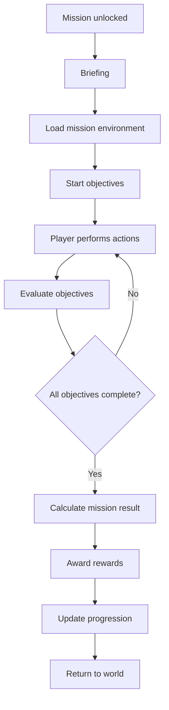

## 11.4 Tactical systems

Potential mechanics include:

- Movement.
- Interaction.
- Visibility.
- Detection.
- Noise.
- Environmental cover.
- Non-lethal equipment.
- Mission timers.
- Objective tracking.

## 11.5 Elegance score

The game may evaluate mission performance using an elegance score.

Example factors:

| Factor | Possible effect |
|---|---|
| Objective completion | Increases score |
| Remaining undetected | Increases score |
| Time efficiency | Increases score |
| Evidence collected | Increases score |
| Unnecessary disruption | Reduces score |
| Failed objectives | Reduces score |

The final formula should be documented and tested.

## 11.6 Implementation guidance

Start with simple, reliable mechanics.

A mission should be completable with:

- Clear objectives.
- Responsive controls.
- Visible feedback.
- Correct collision and interaction behavior.
- Accurate completion detection.
- Reliable reward calculation.

Avoid building complex enemy AI before the basic mission loop works.

---

# 12. Cooking, Baking, and Catering

## 12.1 Culinary system overview

The culinary pillar should provide a complete activity loop.

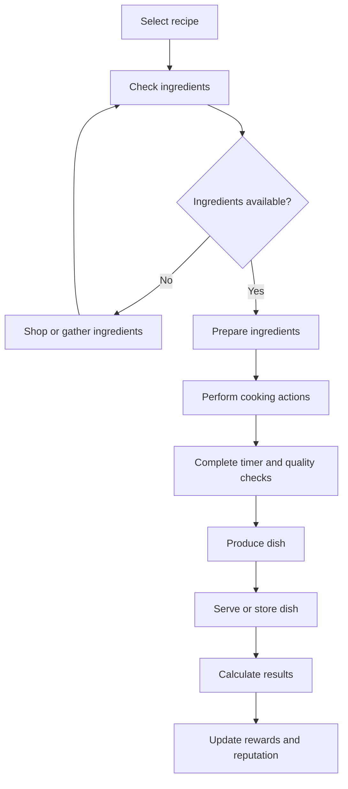

## 12.2 Ingredient data

```ts
interface Ingredient {
  id: string;
  name: string;
  category: string;
  freshnessDays?: number;
  purchasePrice: number;
  quality: number;
}
```

## 12.3 Recipe data

```ts
interface Recipe {
  id: string;
  name: string;
  description: string;
  ingredientIds: string[];
  preparationTimeSeconds: number;
  cookingTimeSeconds: number;
  difficulty: number;
  baseQuality: number;
  unlockLevel: number;
}
```

## 12.4 Cooking quality

Quality can be influenced by:

- Ingredient quality.
- Ingredient freshness.
- Preparation accuracy.
- Timing.
- Equipment.
- Player skill.
- Recipe difficulty.

The formula should have sensible limits.

## 12.5 Kitchen progression

Potential kitchen upgrades:

- Better ovens.
- Improved work surfaces.
- Storage.
- Ingredient organization.
- Additional preparation stations.
- Specialized equipment.

Each upgrade should have a cost and a clear gameplay benefit.

## 12.6 Catering

Catering events may require:

- Event type.
- Guest count.
- Budget.
- Menu.
- Preparation deadline.
- Ingredient requirements.
- Staff assignments.
- Guest preferences.

## 12.7 Guest satisfaction

A satisfaction model may consider:

```text
Guest satisfaction =
    Food quality
  + Service quality
  + Menu suitability
  + Event organization
  - Delays
  - Missing orders
  - Service disruptions
```

The actual implementation should define numerical ranges and prevent invalid scores.

## 12.8 Culinary achievements

Examples:

- Complete the first recipe.
- Prepare five perfect dishes.
- Host a successful dinner.
- Discover a hidden recipe.
- Complete a catering event within budget.
- Achieve a high guest satisfaction rating.

---

# 13. Estate and Household Management

## 13.1 Estate overview

The estate system gives the player a long-term management objective.

It should support:

- Property development.
- Building upgrades.
- Staff management.
- Household scheduling.
- Maintenance.
- Budgets.
- Interior customization.
- Exterior improvements.
- Estate prestige.

## 13.2 Building data

```ts
interface Building {
  id: string;
  name: string;
  level: number;
  upgradeCost: number;
  maintenanceCost: number;
  unlocked: boolean;
  condition: number;
}
```

## 13.3 Building progression

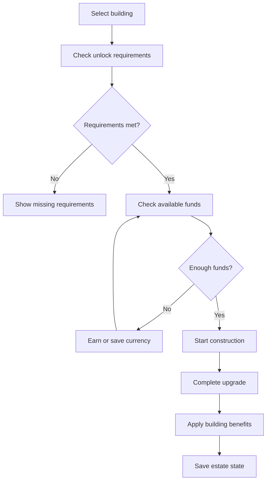

## 13.4 Staff management

Potential staff roles:

- Butler.
- Cook.
- Housekeeper.
- Gardener.
- Maintenance worker.
- Event assistant.

Staff records may include:

```ts
interface StaffMember {
  id: string;
  name: string;
  role: string;
  skillLevel: number;
  morale: number;
  assignedBuildingIds: string[];
  wagePerDay: number;
}
```

## 13.5 Staff systems

The player may manage:

- Hiring.
- Training.
- Schedules.
- Assignments.
- Wages.
- Morale.
- Workload.
- Delegation.

## 13.6 Estate finances

The estate should track:

- Construction costs.
- Maintenance.
- Staff wages.
- Utilities.
- Event income.
- Property income, if supported.
- Available funds.

The interface should show the cost before confirming a purchase or upgrade.

---

# 14. Neighborhood Simulation

## 14.1 The neighborhood as a living world

The neighborhood should respond to the player's actions.

Possible world activities:

- Community meetings.
- Social gatherings.
- Neighborhood projects.
- Competitions.
- Local disputes.
- Gossip.
- Seasonal celebrations.
- Character visits.
- Community rules.

## 14.2 Community reputation

Reputation may be tracked across multiple categories.

Example:

```ts
interface ReputationState {
  hospitality: number;
  elegance: number;
  reliability: number;
  influence: number;
  communityStanding: number;
}
```

These categories should be used only if they provide distinct gameplay value.

## 14.3 Gossip system

Gossip can create narrative opportunities.

A gossip record may contain:

- Source character.
- Subject character.
- Information.
- Reliability.
- Discovery date.
- Whether it has been verified.
- Related clues.

The player should be able to distinguish rumor from confirmed information.

## 14.4 Community decisions

A community decision can have multiple outcomes.

Example:

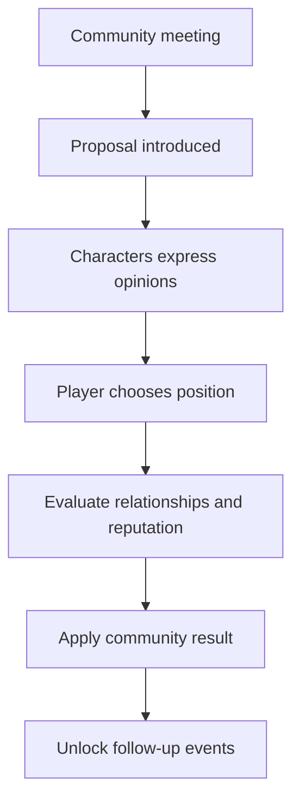

## 14.5 World events

Potential event categories:

- Daily events.
- Weekly events.
- Seasonal events.
- Character-specific events.
- Story events.
- Random encounters.

Events should be controlled by explicit conditions and not generated in ways that break the story or duplicate rewards.

---

# 15. Economy and Progression

## 15.1 Economy objectives

The economy should create meaningful decisions without making basic gameplay unnecessarily frustrating.

Potential resources:

- Currency.
- Experience.
- Ingredients.
- Materials.
- Equipment.
- Reputation.
- Estate prestige.

## 15.2 Economy rules

All economic changes should pass through a central service.

For example:

```ts
interface EconomyTransaction {
  id: string;
  amount: number;
  reason: string;
  category: "income" | "expense" | "reward";
  createdAt: number;
}
```

A purchase should not be allowed if the player has insufficient funds.

## 15.3 Progression

Progression can include:

- Player levels.
- Skill levels.
- Recipe unlocks.
- Mission unlocks.
- Estate upgrades.
- Character relationships.
- Story chapters.
- Achievements.

## 15.4 Experience flow

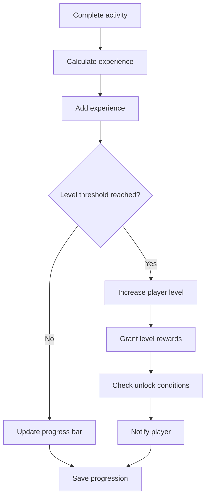

## 15.5 Achievement system

Achievements should be data-driven.

Example:

```ts
interface Achievement {
  id: string;
  title: string;
  description: string;
  requirementType: string;
  targetValue: number;
  rewardIds: string[];
}
```

## 15.6 Economic balancing

Track:

- Average player income.
- Average activity cost.
- Upgrade prices.
- Ingredient costs.
- Reward values.
- Time required to earn resources.

Avoid unlimited reward loops and accidental currency duplication.

---

# 16. Saving, Loading, and Persistence

## 16.1 Persistence objectives

Players should be able to:

- Start a new game.
- Save progression.
- Load an existing game.
- Recover from a page refresh.
- Continue previously completed quests.
- Retain inventory and currency.
- Preserve relationships and world flags.

## 16.2 Browser storage

For a browser-only prototype:

- LocalStorage can store small, straightforward save records.
- IndexedDB is more suitable for larger structured data.

Choose one primary persistence strategy and document it.

Do not assume browser storage is permanent or backed up.

## 16.3 Save architecture

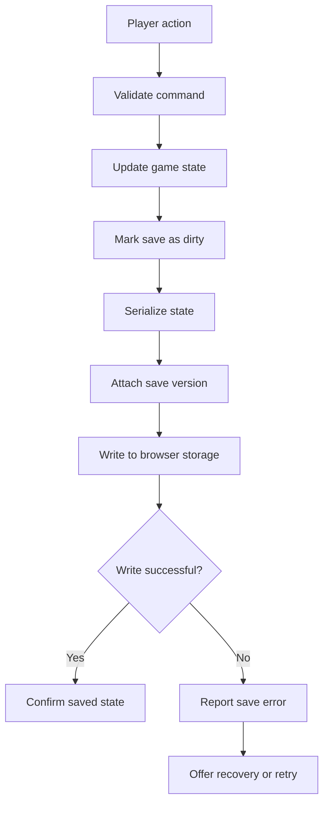

## 16.4 Save record

A conceptual save record:

```ts
interface SaveRecord {
  version: number;
  savedAt: string;
  gameState: GameState;
}
```

## 16.5 Version migration

When the structure changes, old saves may need migration.

Example:

```ts
function migrateSave(
  save: unknown
): SaveRecord {
  // Validate the incoming save.
  // Detect its version.
  // Apply required migrations.
  // Return a validated current save.
  throw new Error("Implement migration logic");
}
```

This example is intentionally a placeholder, not a working migration implementation.

## 16.6 Save safety

Recommended safeguards:

- Validate data before loading.
- Handle missing values.
- Handle invalid JSON.
- Avoid overwriting a good save with invalid data.
- Keep a backup where practical.
- Show save status.
- Provide an explicit reset option.
- Explain that clearing browser data can remove local saves.

## 16.7 Cloud saves

Cloud saves are a future feature requiring:

- User accounts.
- Backend infrastructure.
- Authentication.
- Authorization.
- Secure storage.
- Conflict handling.
- Privacy documentation.

Do not imply cloud saving exists until it has been implemented and tested.

---

# 17. User Interface and Accessibility

## 17.1 Interface principles

The UI should be:

- Clear.
- Consistent.
- Responsive.
- Easy to navigate.
- Visually coherent.
- Accessible.
- Informative without being overwhelming.

## 17.2 Suggested main navigation

Potential navigation areas:

```text
HOME
├── World Map
├── Characters
├── Quests
├── Action Missions
├── Kitchen
├── Catering
├── Estate
├── Inventory
├── Journal
├── Achievements
└── Settings
```

Only show sections that are implemented or intentionally presented as locked features.

## 17.3 Screen layout

A possible game interface:

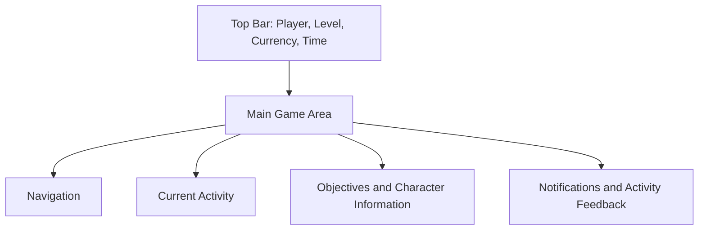

## 17.4 Responsive behavior

The interface should adapt to:

- Desktop monitors.
- Laptops.
- Tablets.
- Mobile browsers.

On smaller screens:

- Collapse navigation.
- Avoid horizontal overflow.
- Make buttons touch-friendly.
- Keep important information visible.
- Use readable text sizes.
- Avoid layouts that require precise mouse movement.

## 17.5 Accessibility requirements

Recommended standards:

- Semantic HTML.
- Keyboard navigation.
- Visible focus indicators.
- Accessible form labels.
- Sufficient color contrast.
- Alternative text for meaningful images.
- Reduced-motion support.
- Screen-reader-friendly status messages.
- Clear error descriptions.

Color should not be the only way to communicate success, failure, rarity, or warnings.

## 17.6 Feedback

Every important player action should have visible feedback.

Examples:

- Purchase successful.
- Insufficient funds.
- Quest completed.
- Recipe unlocked.
- Save successful.
- Mission failed.
- Relationship improved.

---

# 18. Testing, Quality, and Security

## 18.1 Testing strategy

Testing should cover the game systems independently and together.

| Test type | Purpose |
|---|---|
| Unit | Verify individual functions |
| Integration | Verify connected systems |
| UI | Verify component behavior |
| End-to-end | Verify player journeys |
| Regression | Prevent old bugs from returning |
| Performance | Identify slow interactions |
| Accessibility | Check usability and accessibility |

## 18.2 Important gameplay tests

### Economy

- Currency cannot become negative through invalid purchases.
- Purchases deduct the correct amount.
- Rewards are not duplicated.
- Failed purchases do not modify inventory.

### Cooking

- Recipes require correct ingredients.
- Ingredients are consumed correctly.
- Cooking results use valid quality values.
- Timers complete correctly.
- Rewards are applied once.

### Quests

- Prerequisites are checked.
- Objectives update correctly.
- Completed quests cannot be accidentally completed again unless repeatable.
- Rewards are granted once.

### Relationships

- Values remain within their defined range.
- Dialogue conditions are respected.
- Relationship changes are saved.
- Character records remain consistent.

### Persistence

- New games initialize correctly.
- Existing saves load correctly.
- Invalid saves are handled safely.
- Refreshing the browser does not unexpectedly erase progress.

## 18.3 Security

For a client-side browser game:

- Never store passwords in LocalStorage.
- Never include private API keys in frontend source.
- Validate imported content.
- Sanitize user-generated text before rendering.
- Avoid unsafe HTML injection.
- Validate any future server requests.
- Restrict account access through server-side authorization.
- Avoid trusting client-side currency or progression values in competitive online features.

## 18.4 Content security

All content should be original or appropriately licensed.

This includes:

- Characters.
- Dialogue.
- Storylines.
- Artwork.
- Music.
- Sound effects.
- Logos.
- Fonts.
- Other third-party assets.

Keep records of asset sources and license requirements.

## 18.5 Definition of done

A feature is not finished merely because its screen exists.

A feature should be considered complete when:

1. The player can access it.
2. The main interaction works.
3. Requirements are validated.
4. Results are visible.
5. Progression updates correctly.
6. Save data is updated.
7. Errors are handled.
8. Relevant tests pass.
9. The feature works at supported screen sizes.

---

# 19. Development, Build, and Deployment

## 19.1 Getting the project

Clone the repository:

```bash
git clone https://github.com/lucylow/bree-web-game.git
cd bree-web-game
```

## 19.2 Install dependencies

For an npm-based project:

```bash
npm install
```

Use the repository's committed lockfile and preferred package manager.

If the repository uses a different package manager, follow its configuration instead.

## 19.3 Run the development server

For a standard Vite project:

```bash
npm run dev
```

The terminal should display the local development address.

Open that address in a modern browser.

## 19.4 Build for production

For a standard Vite project:

```bash
npm run build
```

The production output is normally created in:

```text
dist/
```

Verify the actual scripts in `package.json` before relying on these commands.

## 19.5 Preview production output

For a standard Vite project:

```bash
npm run preview
```

This helps verify the built application locally.

## 19.6 Recommended scripts

A typical project may define:

```json
{
  "scripts": {
    "dev": "vite",
    "build": "tsc -b && vite build",
    "preview": "vite preview",
    "typecheck": "tsc --noEmit",
    "test": "vitest run"
  }
}
```

These are suggested scripts, not verified contents of the current repository.

Only add scripts when the corresponding tools and configuration exist.

## 19.7 Deployment architecture

A browser-first build can be hosted on a static hosting provider.

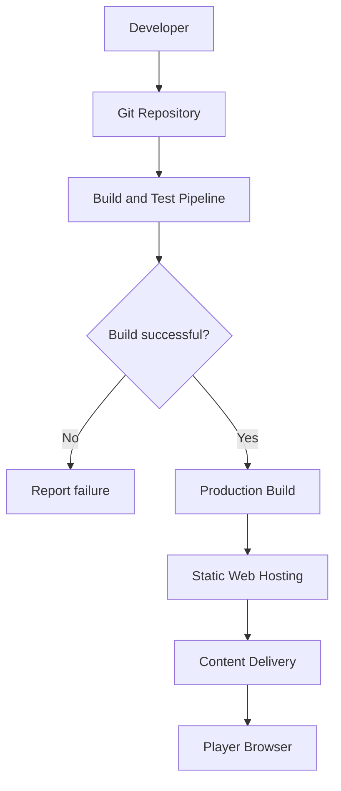

## 19.8 Deployment checklist

Before publishing:

- Confirm the production build succeeds.
- Test the production preview.
- Check browser console errors.
- Verify all images and assets load.
- Test navigation.
- Test save and load.
- Test responsive layouts.
- Confirm there are no exposed secrets.
- Verify deployment paths and routing.
- Confirm the published version matches the intended release.

## 19.9 Environment configuration

If future services require configuration, use environment variables.

Never place private credentials in public frontend environment variables.

Any variable bundled into a browser application should be treated as publicly visible.

---

# 20. Roadmap, Contribution, and Project Standards

## 20.1 Development roadmap

The roadmap below is a proposed sequence, not a claim about current completion.

### Phase 1 — Foundation

- [ ] Verify the existing application builds.
- [ ] Confirm React and TypeScript configuration.
- [ ] Establish the main application layout.
- [ ] Create navigation.
- [ ] Define shared game data types.
- [ ] Establish error handling.
- [ ] Establish a basic save system.

### Phase 2 — Core gameplay

- [ ] Implement player profile.
- [ ] Implement currency.
- [ ] Implement inventory.
- [ ] Implement player progression.
- [ ] Implement world time.
- [ ] Implement notifications.
- [ ] Implement activity selection.

### Phase 3 — Characters and narrative

- [ ] Implement character records.
- [ ] Implement relationship values.
- [ ] Implement dialogue.
- [ ] Implement branching choices.
- [ ] Implement quests.
- [ ] Implement story flags.
- [ ] Implement a journal.

### Phase 4 — Culinary gameplay

- [ ] Implement ingredient inventory.
- [ ] Implement recipe data.
- [ ] Implement cooking actions.
- [ ] Implement cooking timers.
- [ ] Implement dish quality.
- [ ] Implement catering events.
- [ ] Implement guest satisfaction.

### Phase 5 — Estate gameplay

- [ ] Implement estate dashboard.
- [ ] Implement building records.
- [ ] Implement building upgrades.
- [ ] Implement staff management.
- [ ] Implement estate expenses.
- [ ] Implement prestige progression.
- [ ] Implement household events.

### Phase 6 — Action gameplay

- [ ] Implement mission selection.
- [ ] Implement mission objectives.
- [ ] Implement player movement.
- [ ] Implement environmental interaction.
- [ ] Implement detection mechanics.
- [ ] Implement mission scoring.
- [ ] Implement mission rewards.

### Phase 7 — World simulation

- [ ] Implement neighborhood events.
- [ ] Implement character schedules.
- [ ] Implement gossip and secrets.
- [ ] Implement community decisions.
- [ ] Implement reputation.
- [ ] Implement seasonal content.

### Phase 8 — Quality and release

- [ ] Complete unit tests.
- [ ] Complete integration tests.
- [ ] Complete browser testing.
- [ ] Test mobile layouts.
- [ ] Improve accessibility.
- [ ] Optimize loading and rendering.
- [ ] Verify save compatibility.
- [ ] Publish a production build.

## 20.2 Contribution guidelines

Contributions should improve the project without making unrelated systems unstable.

Recommended workflow:

1. Review the existing architecture.
2. Identify the relevant feature.
3. Create a focused branch.
4. Make a small, understandable change.
5. Add or update tests.
6. Run type checking.
7. Run the production build.
8. Review the changes.
9. Submit a pull request.

Suggested branch names:

```text
feature/character-dialogue
feature/cooking-system
feature/estate-management
fix/save-validation
fix/responsive-navigation
docs/readme-update
```

## 20.3 Commit conventions

Suggested commit prefixes:

```text
feat: add recipe discovery
fix: correct inventory deduction
docs: update setup instructions
test: add quest completion tests
refactor: separate economy logic
style: improve responsive layout
perf: optimize character rendering
```

## 20.4 Issue reporting

A useful bug report should include:

- Short title.
- Browser and operating system.
- Steps to reproduce.
- Expected behavior.
- Actual behavior.
- Screenshots where useful.
- Relevant console errors.
- Whether the issue happens consistently.

Do not include passwords, private keys, or personal account information in public issues.

## 20.5 Documentation standards

Documentation should explain:

- What a system does.
- Where its code lives.
- What data it requires.
- How it interacts with other systems.
- How to test it.
- Known limitations.
- Whether the feature is planned or implemented.

Update documentation when behavior changes.

## 20.6 Project acceptance criteria

A release candidate should satisfy these minimum requirements:

| Area | Acceptance requirement |
|---|---|
| Startup | Application launches without blocking errors |
| Navigation | Main implemented screens can be reached |
| Gameplay | Core activities have working interactions |
| Data | Content records have stable identifiers |
| State | Player actions update the correct state |
| Economy | Transactions are validated |
| Quests | Objectives and rewards work correctly |
| Persistence | Saves can be loaded and validated |
| UI | Supported screen sizes are usable |
| Accessibility | Basic keyboard and semantic accessibility requirements are met |
| Testing | Critical gameplay flows have automated or documented tests |
| Production | Production build completes successfully |

## 20.7 Long-term direction

Future expansions may include:

- Additional story chapters.
- New characters.
- More neighborhood locations.
- More recipes and catering events.
- Additional estate buildings.
- More tactical missions.
- Seasonal events.
- More detailed character schedules.
- New achievements.
- New Game+.
- Challenge modes.
- Additional customization.
- Optional account-based cloud saves.
- Multiplayer features, if the project later justifies the infrastructure and design complexity.

These features should be introduced only after the core single-player experience is stable.

---

# Final Project Principles

BREE should be developed as a connected, data-driven browser game.

The most important engineering principles are:

1. **Working gameplay over decorative mockups.** Every visible interaction should work or be clearly identified as unavailable.
2. **One coherent world state.** Shared systems should use consistent data and rules.
3. **Modular architecture.** Features should be independently understandable and testable.
4. **Persistent progression.** Important player actions should survive a browser refresh.
5. **Original content.** All creative material must be original or properly licensed.
6. **Testable mechanics.** Economy, quests, relationships, cooking, missions, and saves should have verifiable outcomes.
7. **Incremental development.** Build a reliable foundation before adding complexity.
8. **Honest documentation.** Never label planned features as implemented or tested features as released without evidence.

## Quick Links

- **Repository:** https://github.com/lucylow/bree-web-game
- **Issues:** https://github.com/lucylow/bree-web-game/issues
- **Pull Requests:** https://github.com/lucylow/bree-web-game/pulls
- **GitHub Actions:** https://github.com/lucylow/bree-web-game/actions

---

<p align="center">
  <strong>BREE</strong>
  <br />
  <em>Elegance is an art. Management is a strategy. Every choice has a consequence.</em>
</p>
